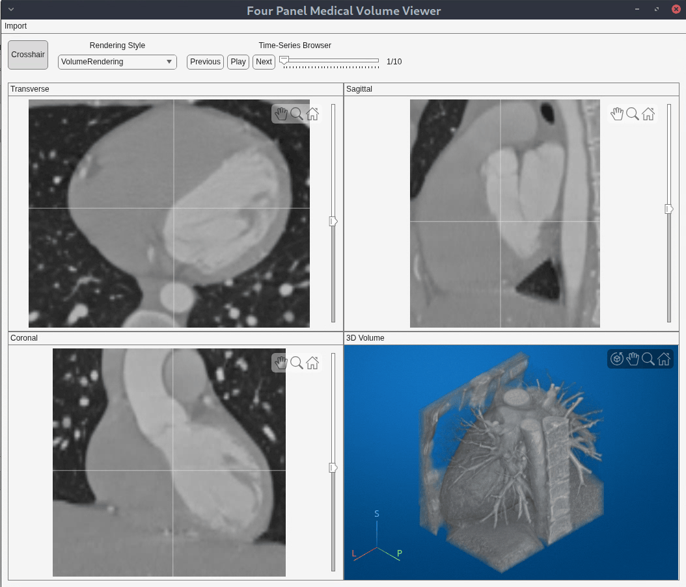

# Four Panel Medical Viewer App

A MATLAB&reg; App Designer example that lets researchers and developers explore 3-D and 4-D medical image volumes interactively in MATLAB — without switching to a separate DICOM viewer. The `FourPanelMedicalViewerApp` app displays a medical volume simultaneously in three orthogonal 2-D slice views (transverse, sagittal, and coronal) and in a 3-D volume rendering, with support for file/folder/PACS import, synchronized crosshair navigation, multiple 3-D rendering styles, and 4-D time-series playback. Because it is delivered as an App Designer example, you can extend it with your own UI components — intensity windowing, ROI drawing, custom measurements — to fit the visualization tasks in your own workflow.

## Features

* **Multi-source data import** — Load medical volumes from single files (DICOM, NIfTI, NRRD), from a folder containing a DICOM series, or from a PACS server through the embedded `PACSConnectionApp`.
* **Synchronized orthogonal views** — Visualize a medical volume in transverse, sagittal, and coronal 2-D slice viewers together with a 3-D volume rendering, all kept in sync.
* **Interactive crosshair navigation** — Drag the crosshair in any 2-D panel to update slice indices across all views. Scroll through slices using the mouse wheel or the vertical slider.
* **3-D rendering styles** — Switch between `VolumeRendering`, `MaximumIntensityProjection`, and `GradientOpacity` rendering.
* **4-D time-series playback** — Automatically detect 4-D time-varying volumes (for example, cardiac cine or dynamic contrast-enhanced data) and step through frames using previous/next buttons, a slider, or animated playback.
* **Reusable custom UI components** — Use the `FourPanelMedicalViewer` and `ImageStackScrubber` components in standalone mode or embed them in your own apps.

## Setup

### MathWorks Products (https://www.mathworks.com)

Requires MATLAB release R2026b or newer.

* [MATLAB&reg;](https://www.mathworks.com/products/matlab.html)
* [Image Processing Toolbox&trade;](https://www.mathworks.com/products/image.html)
* [Medical Imaging Toolbox&trade;](https://www.mathworks.com/products/medical-imaging.html)

## Installation

1. Clone or download this repository.
2. Open MATLAB and set the repository folder as the current working folder, or add it to the MATLAB path.
3. Open the `ImageStackScrubber.mlapp` and `FourPanelMedicalViewer.mlapp` custom UI components in App Designer. In the **Designer** tab of the App Designer toolstrip, select **Configure for Apps**, then select **OK** in the dialog. When the metadata-updated success message appears, select **Add to Path**. Repeat for both components.

## Getting Started

Open `FourPanelMedicalViewerApp.m` in App Designer or see the [guided walkthrough](https://www.mathworks.com/help/medical-imaging/ug/create-an-app-to-explore-3d-and-4d-medical-volumes-with-synchronized-multipanel-views.html) on the documentation page.

## Example Files

| File | Description |
| ---- | ----------- |
| `FourPanelMedicalViewerApp.m` | Main app that assembles the toolstrip, working area, and data-import workflows. |
| `FourPanelMedicalViewer.mlapp` | Custom UI component providing four synchronized panels (transverse, sagittal, coronal, 3-D). |
| `ImageStackScrubber.mlapp` | Custom UI component providing a single-plane 2-D slice viewer with a vertical slider and crosshair interaction. |
| `PACSConnectionApp.m` | Dialog app for connecting to a PACS server, querying, and retrieving DICOM data. |
| `PACSConfigManager.m` | Utility class for managing PACS connection configurations. |
| `FourPanelMedicalViewerApp.xml` | Main app component layout data |
| `PACSConnectionApp.xml` | PACS Connection App component layout data |

## License

The license is available in the `license.txt` file in this repository.

## Community Support

[MATLAB Central](https://www.mathworks.com/matlabcentral)

Copyright 2026 The MathWorks, Inc.
